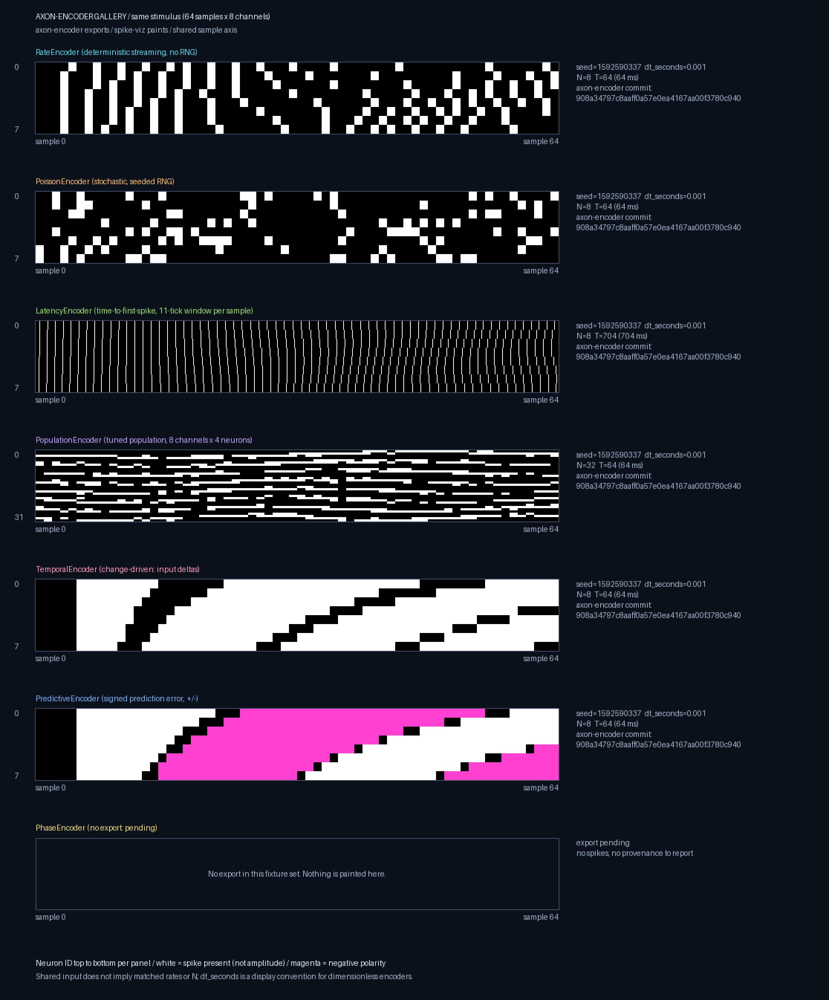

# Encoder gallery: one stimulus, every axon-encoder strategy



One raster per current axon-encoder strategy: Rate, Poisson, Latency,
Population, Temporal, Predictive and Phase. Every panel paints a checked-in
Rust export; spike-viz does not encode or invent anything. Panels are stacked
vertically on a **shared stimulus-sample axis**, so the same input sample lines
up in every row. Each panel carries a visible caption, and the PNG also stores it
as a textual `Description`. The caption gives the encoder mode, seed,
`dt_seconds`, N, T and the full axon-encoder commit.

## Render from the checked-in exports

From the repository root after [installing spike-viz](../README.md#install):

```bash
python - <<'PY'
from spike_viz import render_encoder_gallery

root = "fixtures/axon-encoder/{}/shared_sine_v1"
render_encoder_gallery(
    {
        **{e: root.format(e) for e in (
            "rate", "poisson", "latency", "population", "temporal", "predictive",
        )},
        "phase": None,  # no PhaseEncoder export yet; painted as "pending"
    },
    rate_mode="streaming",
    out_path="docs/images/encoder-gallery.png",
)
PY
```

All seven encoder keys are required. `None` states that no export exists. That
slot shows an outlined "pending" panel with no raster, no spikes and no
provenance, and its caption says so. A path that does not load still raises
`SpikeIOError`. Every supplied export must have `synthetic: false`, a full
40-hex `axon_encoder_git_sha` and a `stimulus.npy` equal to the shared stimulus.
Otherwise rendering fails. `rate_mode` is mandatory for the same reason as in
the [Rate vs Poisson hero](rate-vs-poisson-hero.md): the export does not
record it.

## Reading the panels honestly

| Panel | Mode shown | N | T | Notes |
|-------|-----------|---|---|-------|
| Rate | deterministic streaming, no RNG | 8 | 64 | `encode_step`; the seed is provenance only |
| Poisson | stochastic, seeded RNG | 8 | 64 | Rate mapping differs from Rate (50–350 Hz vs 50–400 Hz) |
| Latency | time-to-first-spike, 11-tick window per sample | 8 | 704 | `TimeModel::window`: 64 samples × 11 ticks |
| Population | tuned population, 8 channels × 4 neurons | 32 | 64 | Neuron axis is stretched to the shared panel height |
| Temporal | change-driven: input deltas | 8 | 64 | Fires on input change thresholds |
| Predictive | signed prediction error, +/- | 8 | 64 | Magenta = negative polarity (`amp < 0`) |
| Phase | **pending** | – | – | No PhaseEncoder fixture yet |

- **Shared stimulus.** Every export uses the same 64 × 8 sine/ramp input. The
  latency export holds each sample for its 11-tick window, so its `stimulus.npy`
  is the shared input repeated row by row. The renderer checks this exactly and
  rejects any other stimulus. The shared input does not mean the encoders were
  matched on rate, N or expected spike count.
- **Shared time axis.** All panels have the same width, covering stimulus
  samples 0–64. Latency's 704 ticks therefore share the width that the 64-tick
  panels use. The panel width is the least common multiple of every T, and the
  height is a multiple of the LCM of every N. Bins are therefore only ever
  upsampled by whole factors (nearest-neighbour): no event is dropped and
  sample boundaries line up. Exports whose T values have an LCM above 2048,
  or whose N values have an LCM above 1024, raise `SpikeIOError` rather than
  being misaligned.
- **Independent neuron axis.** N differs (Population expands each channel to
  4 tuned neurons). Each panel labels its own `0 … N−1` range.
- **`dt_seconds`.** Latency, Population, Temporal, Predictive and Phase are
  dimensionless encoders. For them `dt_seconds` is the export's display
  convention, not a physical claim (see the
  [export contract](axon-encoder-export.md#dt_seconds-semantics)).
- **Colour.** White means a spike is present, not its amplitude. Magenta marks
  bins in which every event has negative polarity.

## Exact fixture source

All six exported panels come from axon-encoder **0.6.0** at
[`908a34797c8aaff0a57e0ea4167aa00f3780c940`](https://github.com/Limen-Neural/axon-encoder/commit/908a34797c8aaff0a57e0ea4167aa00f3780c940),
generated by
[`examples/export_spike_viz.rs`](https://github.com/Limen-Neural/axon-encoder/blob/908a34797c8aaff0a57e0ea4167aa00f3780c940/examples/export_spike_viz.rs)
(seed `0x5EED_0001` = 1592590337). Regenerate them with
`scripts/generate_fixtures.sh`; the steps are in the
[hero guide](rate-vs-poisson-hero.md#exact-fixture-source).

## Remaining: Phase

The pinned exporter has no PhaseEncoder case, so the seventh slot is pending.
Once a `fixtures/axon-encoder/phase/shared_sine_v1` export exists, pass its
path instead of `None` and re-render. The export must use the shared stimulus,
and its `n_steps` must include the trailing `TimeModel::overlapping` slack.
